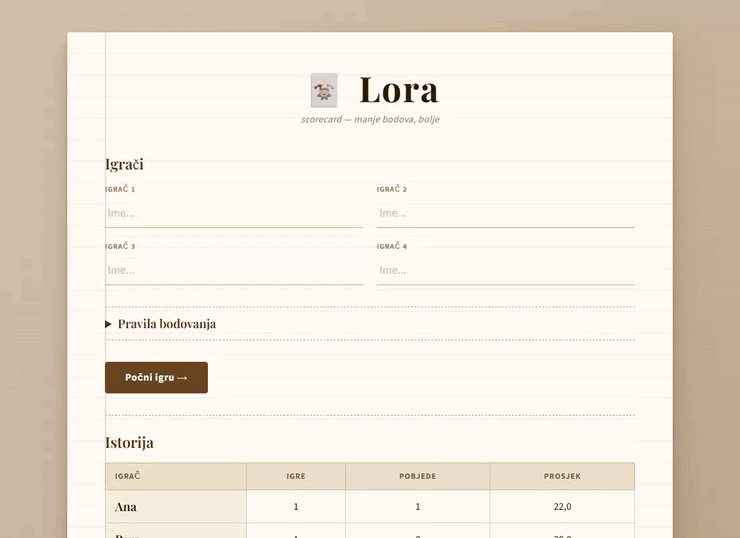
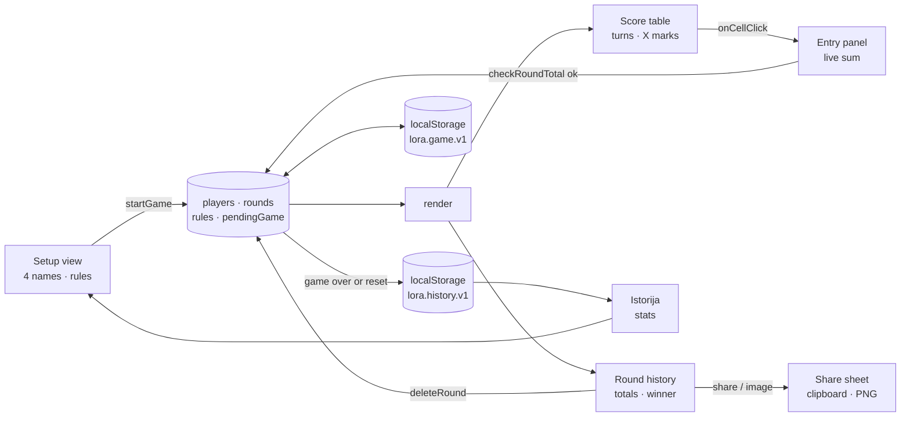
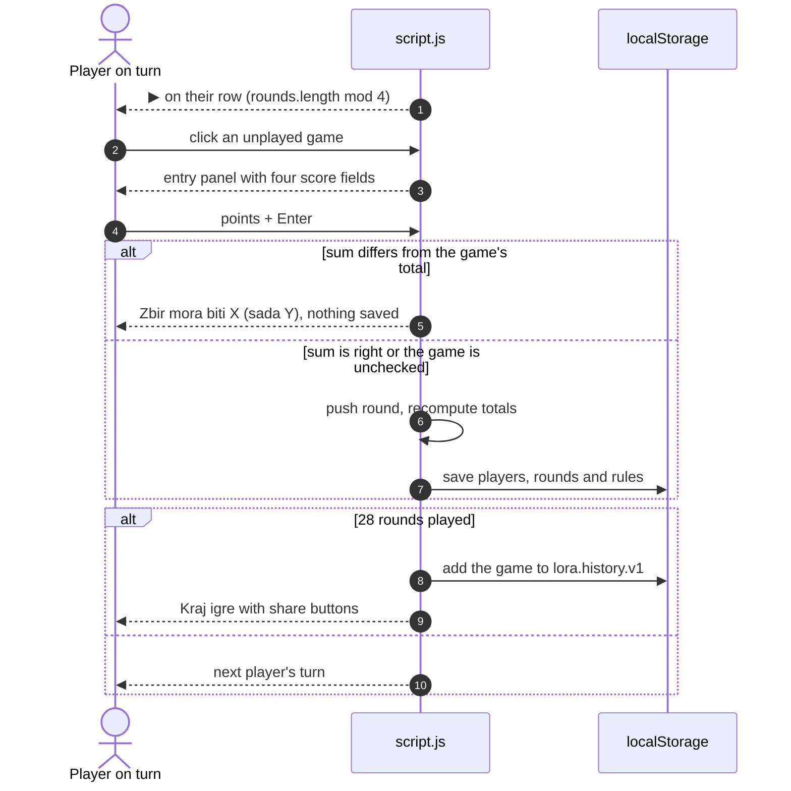

<div align="center">

# 🃏 Lora Score Table

[](https://github.com/pero-grubac/lora-score-table/actions/workflows/ci.yml)
[](https://github.com/pero-grubac/lora-score-table/actions/workflows/deploy.yml)


**A paper-style scorecard for the card game Lora: four players, seven games each, turns, checked round totals, a winner, game history and a shareable result, even offline.**

[](https://pero-grubac.github.io/lora-score-table/)



</div>

---

## 📌 Project Overview

**Lora Score Table** replaces the paper scoresheet for **Lora**, a Balkan trick-taking card game for four players. Each player picks each of the seven games once, in turn; the app tracks whose turn it is, which games are left, the points of every round and the running totals, and checks that every round adds up to the total your table plays with. Lowest total wins.

The interface is in Bosnian/Serbian/Croatian. It runs entirely in the browser with no build step and no dependencies, keeps the game if the page is reloaded, and installs as an offline PWA.

---

## ✨ Features

- 👥 **Four named players**, checked for blanks and duplicates
- 🔄 **Turns**: the player whose turn it is gets a ▶ and a highlighted row; only their unplayed games can be picked
- ✏️ **Inline score entry** right under the player's row; `Tab` between fields, `Enter` to confirm, `Esc` to cancel; negative points are allowed
- ✅ **Round total check**: a live sum next to the inputs turns green when the round adds up; a round with the wrong total is not saved (*Zbir mora biti 8 (sada 9)*)
- ⚙️ **Configurable scoring rules** (*Pravila bodovanja*) before the game and during it, saved with the game
- 📊 **Round history** with the game, who picked it, everyone's points and the totals; the leader is highlighted
- 🗑️ **Delete a round** that was entered wrong
- 🏁 **End of game**: after all 28 rounds the winner (or winners, on a tie) is announced
- 📤 **Share the result**: *Podijeli rezultat* opens the system share sheet (or copies a text summary), *Sačuvaj sliku* downloads the final table as a PNG
- 📚 **Game history and stats**: the last 50 games, with games played, wins and average total per player
- 💾 **Survives a reload**: the game in progress is kept in `localStorage` until **Nova igra**
- 📱 **Phone friendly**: the player column and the score entry stay in view while the table scrolls sideways
- 📶 **Offline PWA** with self-hosted fonts

### 🎴 The seven games

| Game | Icon | Description |
|------|:----:|-------------|
| Plus | ＋ | Collect as many points as possible |
| Minus | − | Collect as few points as possible |
| J tref | ♣ | The player who takes the Jack of Clubs receives a penalty |
| Dame | ♛ | Taking any Queen is forbidden |
| K srca | ♡ | The player who takes the King of Hearts receives a penalty |
| Srcad | ♥ | You must collect all Hearts |
| Lora | ⊕ | The selecting player picks a starting card; the others build on it in sequence |

### 🧮 Scoring rules

Lora is played with 32 cards, so every deal has 8 tricks. Under the default rules each game hands out a fixed number of points, and the four scores of a round must add up to it:

| Game | Default round total | Why |
|------|:-------------------:|-----|
| Plus | −8 | −1 per trick |
| Minus | 8 | 1 per trick |
| J tref | 8 | whoever takes the Jack of Clubs |
| Dame | 8 | 2 per Queen |
| K srca | 8 | whoever takes the King of Hearts |
| Srcad | 8 | 1 per Heart |
| Lora | *no check* | depends on the cards left in hand |

House rules differ, so every total can be changed, or the check switched off (*bez provjere*) per game, in the **Pravila bodovanja** panel on the setup screen and, collapsed, under the game. The rules are saved with the game; a game saved by an older version loads with the defaults, and a new game starts with the rules of the last one played. Fewer points is better.

### 📚 History and stats

When a game ends, or is reset after at least one round, a summary (date, players, totals, winners, rules) goes into `localStorage` under `lora.history.v1`, newest first, at most 50 games. The setup screen shows them under **Istorija** with a per-player table of games played, wins and average total. The stats count finished games only; an abandoned game is listed as *nedovršena*. **Obriši istoriju** clears everything after a confirmation.

### 📤 Sharing

On the end-of-game banner:

- **Podijeli rezultat** uses the Web Share API with a short text (date, ranking, winner). Where sharing isn't available it copies the same text to the clipboard.
- **Sačuvaj sliku** draws the final table (every player's points per game and the total, winner highlighted) on a `<canvas>` in the paper colours and downloads it as `lora-YYYY-MM-DD.png`. No libraries.

---

## 🛠️ Tech Stack

| Technology | Usage |
|------------|-------|
| HTML5 + CSS3 | Layout and the "paper on a table" theme |
| Vanilla JavaScript | Turn logic, scoring, rendering |
| `localStorage` | Game in progress, game history |
| Canvas 2D, Web Share API, Clipboard API | Result image and sharing |
| Playfair Display + Source Sans 3 | Self-hosted WOFF2 fonts |
| Web App Manifest + Service Worker | Install support, offline cache |
| `node:test` | Game logic, rules, history and PWA integrity tests |
| Playwright | End-to-end smoke tests (desktop and mobile) |
| Lighthouse CI | Performance, accessibility, best practices, SEO |
| GitHub Actions + GitHub Pages | CI and deployment |

---

## 📁 Project Structure

```
lora-score-table/
├── index.html              Setup view, rules panel, score table, history, dialogs
├── style.css               Paper theme, table, entry panel, rules, history, mobile rules
├── script.js               Players, turns, rules, scoring, history, sharing, rendering
├── service-worker.js       Offline cache (bypassed on localhost)
├── manifest.json           PWA manifest
├── fonts/                  Playfair Display, Source Sans 3 (WOFF2)
├── icons/                  192 and 512 px app icons
├── tests/
│   ├── helpers.js          Runs script.js in a sandbox with a tiny DOM stub
│   ├── game.test.js        Setup, turns, totals, end of game, reload, escaping
│   ├── rules.test.js       Round total check, live sum, rules editing and persistence
│   ├── history.test.js     History entries, 50-game cap, stats, share text
│   ├── pwa.test.js         Precached files, manifest icons, fonts
│   └── e2e/
│       ├── server.mjs      Zero-dependency static server for the tests
│       └── smoke.spec.js   Rules editor, rejected round, reload, end of game, history
├── readme_assets/demo.gif
├── package.json            npm scripts (start, test, test:e2e); Playwright as the only dev dependency
├── playwright.config.js    Desktop and mobile projects, local server
├── lighthouserc.json       Lighthouse CI settings
└── .github/workflows/
    ├── ci.yml              Unit tests, e2e tests and Lighthouse on pull requests and feature branches
    └── deploy.yml          Unit and e2e tests, then deploy to GitHub Pages
```

---

## 📦 Installation

You need [Git](https://git-scm.com/) and, for the tests and local server only, [Node.js](https://nodejs.org/) 20 or newer.

```bash
git clone https://github.com/pero-grubac/lora-score-table.git
cd lora-score-table
```

The app itself has nothing to install. For the end-to-end tests run `npm install` once (it brings in Playwright).

---

## ▶️ Usage

### Run locally

```bash
npm start                      # http://localhost:8080
# or
python -m http.server 8080
```

The Service Worker does no caching on `localhost`, so changes show up on a normal reload.

### Play

1. Type the four players' names. Open **Pravila bodovanja** if your table plays with other totals, then press **Počni igru →**.
2. The player marked ▶ clicks an empty cell in their row to pick a game.
3. Enter everyone's points for that round (Plus points are negative) and press **Potvrdi** (or `Enter`). The sum under the fields turns green when it matches the game's total.
4. Repeat. Played games show **X**; the round history below keeps every round and the totals.
5. After 28 rounds the winner is shown; share the result or save it as an image. **↺ Nova igra** starts over and the game appears under **Istorija**.

Closing the tab or reloading keeps the current game.

### Run the tests

```bash
npm test                       # unit tests (node:test)
npm install                    # once, for Playwright
npx playwright install chromium
npm run test:e2e               # end-to-end smoke tests, desktop and mobile
```

---

## 🏗️ Architecture



### One round



---

## 🚀 CI/CD

| Workflow | Runs on | What it does |
|----------|---------|--------------|
| `ci.yml` | Pull requests and pushes to branches other than `main` | Three jobs: **unit** (`npm test`), **e2e** (Playwright smoke tests in Chromium, desktop and mobile) and **lighthouse** (Lighthouse CI on exactly the files that get deployed) |
| `deploy.yml` | Push to `main`, or a manual run | Unit tests and e2e tests, then publishes the site to GitHub Pages only if both pass |

Both workflows **skip documentation-only changes** (`*.md`, `readme_assets/`, `LICENSE`, `.gitignore`, `.vscode/`), and a newer run on the same branch cancels the older one. Only the site's files are deployed (`index.html`, `style.css`, `script.js`, `service-worker.js`, `manifest.json`, `fonts/`, `icons/`).

**One-time setup:** **Settings → Pages → Build and deployment → Source** → **GitHub Actions**.

> **On every release** bump `CACHE` in `service-worker.js` (e.g. `lora-v5` → `lora-v6`). Page loads go to the network first, with the cached app as the offline fallback; the other files are served from the cache and refreshed in the background, and old caches are deleted when the new version activates.

---

## 🧭 Design Decisions

- **The rounds are the truth.** Totals, turns, played games and the winner are all derived from the list of rounds, so deleting a round fixes everything at once.
- **Turn = number of rounds mod 4.** No separate turn counter that could get out of sync.
- **Points are entered, not computed, but checked.** Scoring rules for Lora vary from table to table, so the app records the points you type and only checks that a round adds up to the total your table set for that game. That catches the usual mistakes (a missed trick, a wrong sign in Plus) without the app having to know who took which card.
- **Rules live with the game.** Changing a total mid-game applies to the rounds still to come; rounds already played are not re-checked.
- **History is a summary, not a replay.** Only the totals, winners and rules of a game are kept, so 50 games take a few kilobytes.
- **Paper look on purpose.** It replaces a pen-and-paper sheet, so it looks like one.
- **Names are escaped** before they are rendered, so any name is safe to type.

---

<div align="center">

*Manje bodova, bolje.*

</div>
